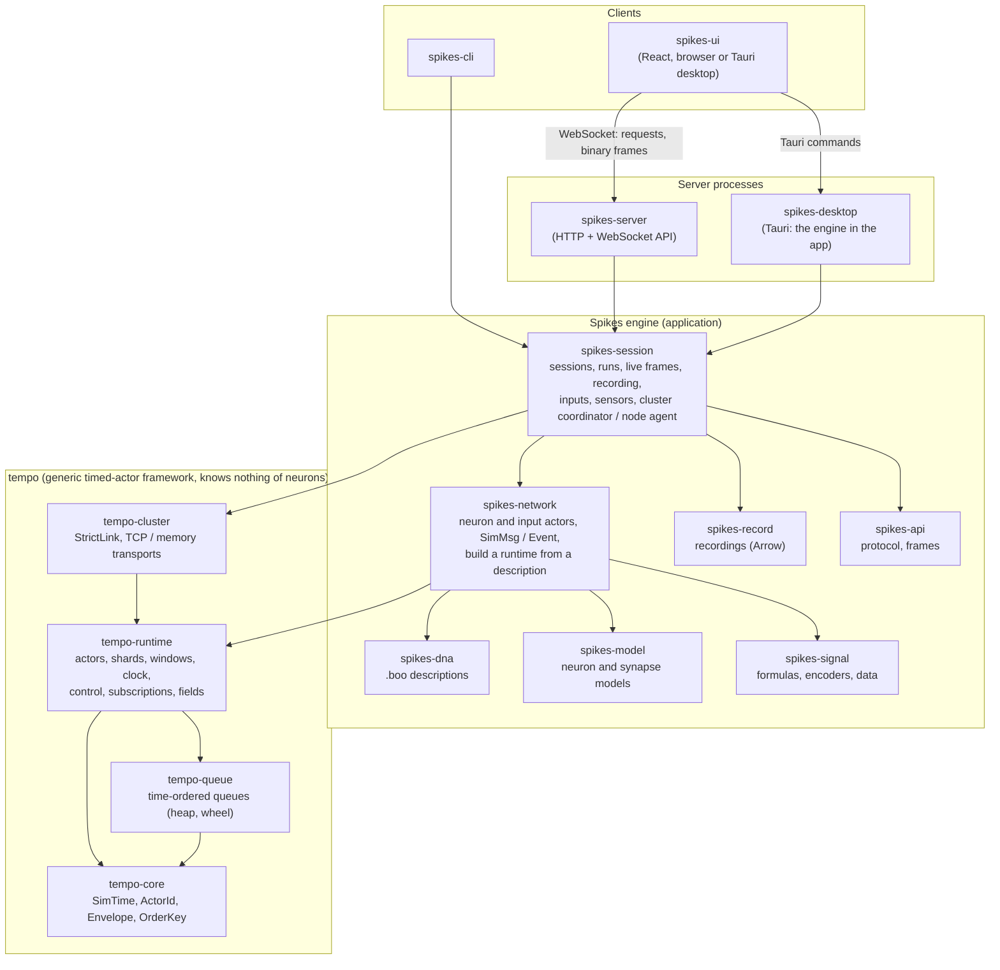

# Architecture

How the engine is put together, with diagrams (Mermaid: GitHub and most Markdown viewers draw them).

| Document | What it covers |
| --- | --- |
| [tempo-runtime.md](tempo-runtime.md) | The `tempo` actor runtime: actors, IDs and partitions, shards, conservative time windows, the window barrier, the clock, the control plane and subscriptions. |
| [tempo-cluster.md](tempo-cluster.md) | One simulation over several processes or hosts: node placement, building a cluster, the strict (lockstep) window protocol, best-effort runs, and how events reach the coordinator. |
| [spikes-on-tempo.md](spikes-on-tempo.md) | How the Spikes app uses `tempo`: a session, a run, and live frames from the shards to the UI. |

Related: [cluster.md](../cluster.md) (running a cluster, for users), `docs/plans/actors/` (the design as planned).

## The layers

The rule that keeps the layers apart: `tempo-*` crates never depend on `spikes-*` crates. `tempo` is a framework for
timed actors in general. Spikes supplies the actors (neurons, inputs), their message type and their event type.
