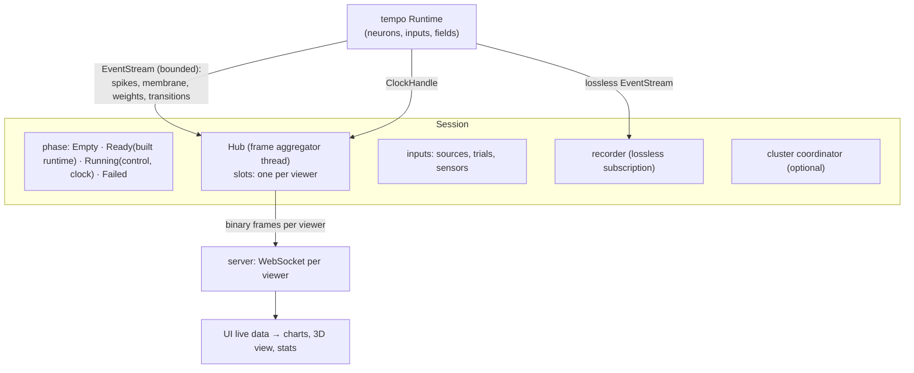
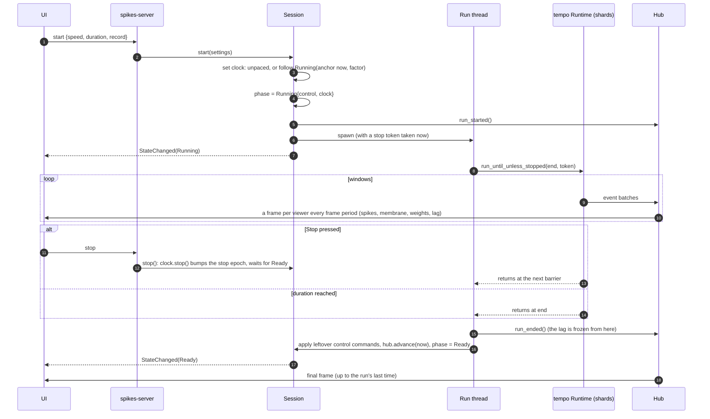
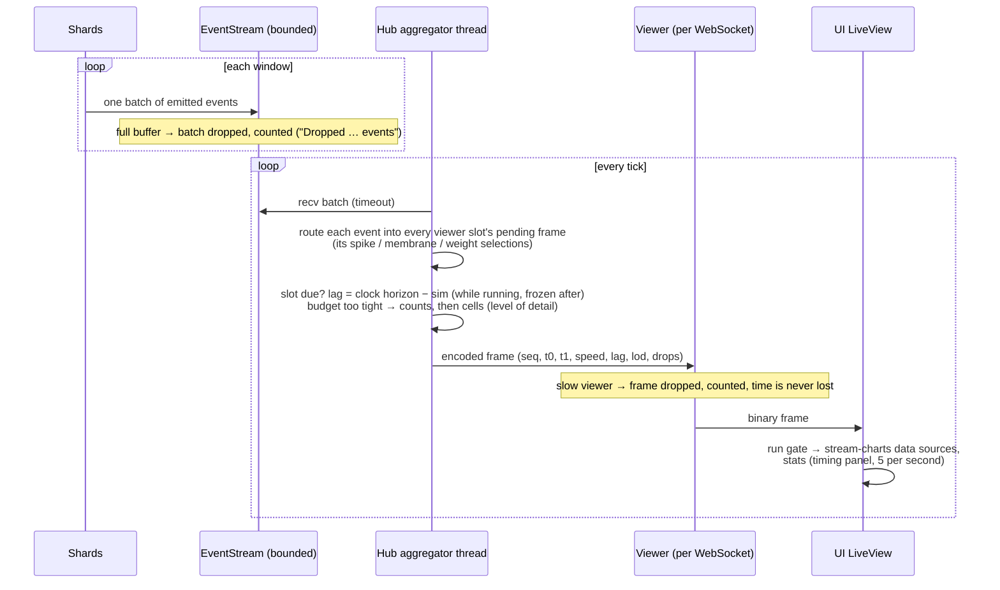

# Spikes on tempo: sessions, runs and live frames

`spikes-network` turns a `.boo` description into tempo actors: neurons, input actors and modulator fields.
`spikes-session` wraps a built runtime in a **session**, which can be built, run, paused, stepped, stopped, inspected,
viewed live and recorded. `spikes-server` (or the desktop app) exposes sessions to the UI.

## A session's parts

## Starting and running

## From events to the UI's charts

The frame header's **behind the clock** (`lag_ms`) is the clock's horizon minus the simulated time the frame
reaches. It is measured only while a run goes. A run's clock keeps its mapping after the simulation stops, so after
the end, frames carry the lag the run last had.

## Code map

| Concern | Where |
| --- | --- |
| Building actors from a description | `crates/spikes-network/src/build.rs` |
| Neuron and input actors, messages, events | `crates/spikes-network/src/{neuron,inputs,messages}.rs` |
| Session phases, start / stop / pause / step | `crates/spikes-session/src/session.rs` |
| Frame aggregator, viewers, level of detail | `crates/spikes-session/src/viewer.rs` |
| Frame format | `crates/spikes-api/src/frame.rs` |
| UI side | `apps/spikes-ui/src/{live,runGate,chartSettings}.ts` |
