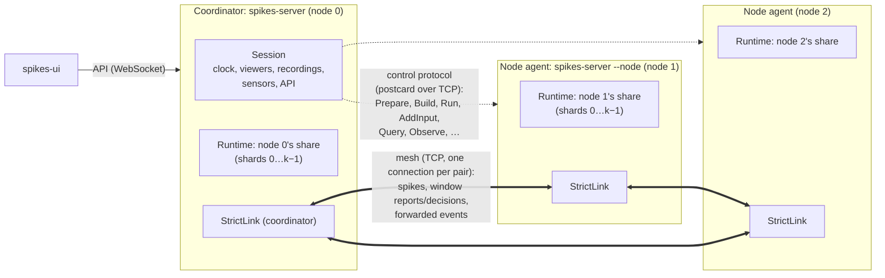
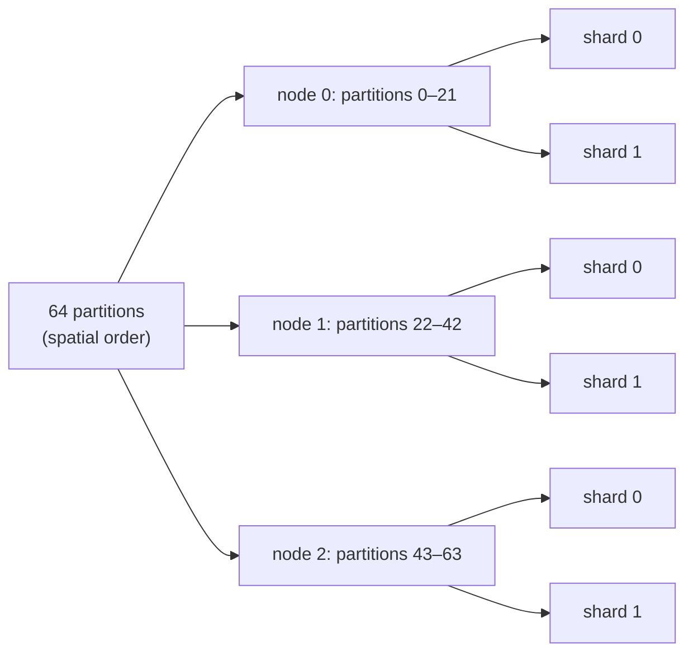
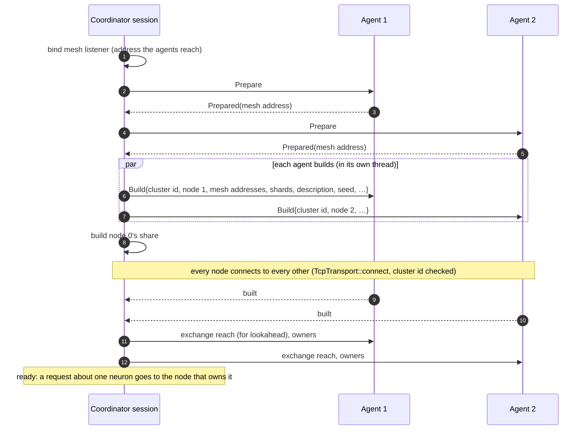
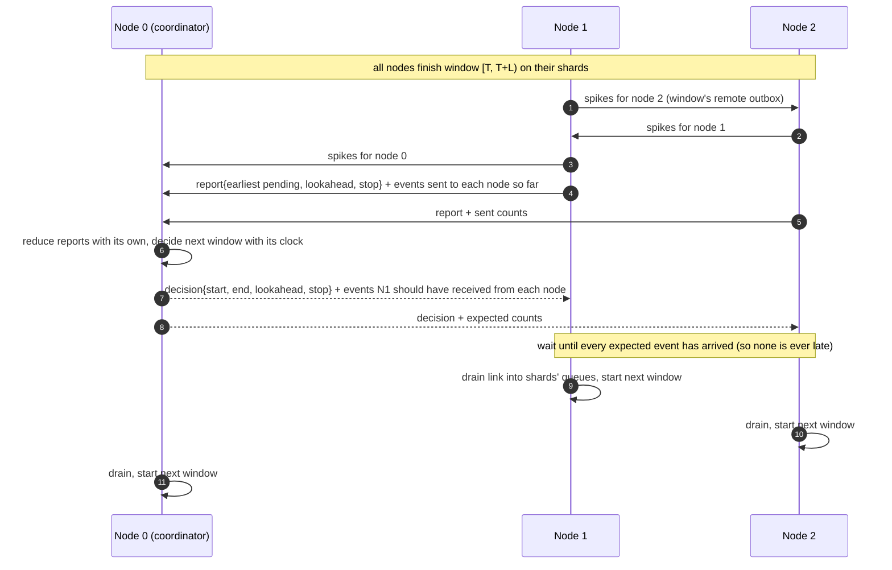
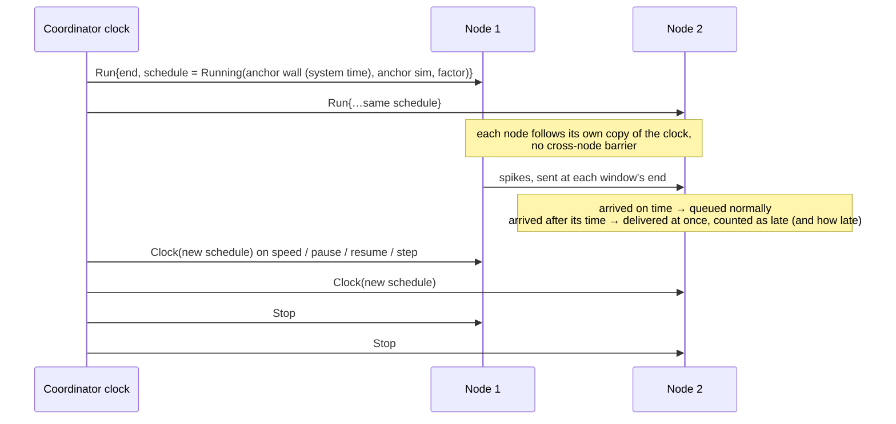
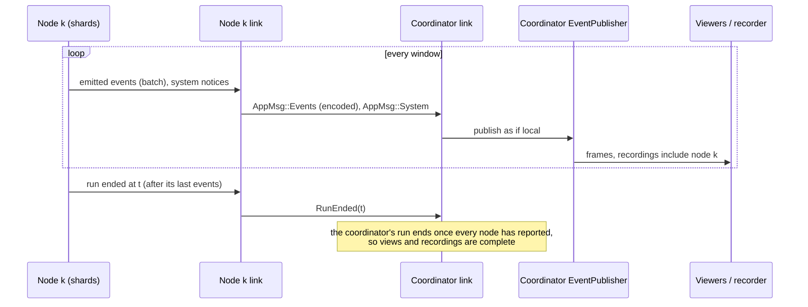

# tempo over several machines

A cluster runs **one** simulation over several processes or hosts ("nodes"). `tempo-runtime` knows how to split
actors over nodes and when to hand messages to another node. `tempo-cluster` supplies the [`Link`] between them: the
transport and the cross-node window protocol. `spikes-session` adds the application side: a coordinator, node agents,
and forwarding of events to the coordinator. For running a cluster, see [cluster.md](../cluster.md).

## Deployment

Two kinds of connection:
- **Control** (coordinator → each agent): request/response for building, running and per-neuron requests.
- **Mesh** (every pair of nodes): the simulation's own traffic. Spikes go straight from node to node, not through
  the coordinator. Window reports and decisions go between each node and the coordinator. Emitted events and system
  notices go to the coordinator.

## Placement across nodes

Every node builds the **same network in the same order**, so every node has the same directory: which ID block
lives on which (node, shard). Each node keeps only its own actors. Partitions go to nodes as contiguous ranges, then
to each node's shards. A description can also pin neurons to a named node. IDs don't depend on placement, so a strict
cluster run gives exactly the results of one process.

## Building a cluster

## A run in lockstep (strict, exact)

Each node runs the ordinary window loop. Its **last shard to reach the barrier** calls `Link::decide`, which makes
the barrier span the cluster:

Each window costs a network round trip, so lockstep across a network is slower, but it is exact to the nanosecond.
Runs as fast as possible always use lockstep.

## A run in best effort

Slower speeds give spikes more slack to cross, so the share of late spikes falls as the speed drops. Clock offsets
between machines show up as lateness, which is why NTP or PTP matters here.

## Seeing the whole network from the coordinator

## Code map

| Concern | Where |
| --- | --- |
| Node placement, `Link` trait, window report/decision | `crates/tempo-runtime/src/cluster.rs` |
| Strict protocol, best effort, arrival statistics | `crates/tempo-cluster/src/link.rs` |
| Memory and TCP transports | `crates/tempo-cluster/src/transport.rs` |
| Wire format (postcard), field codecs, event forwarding | `crates/tempo-cluster/src/wire.rs`, `lib.rs` |
| Coordinator, node agent, control protocol | `crates/spikes-session/src/cluster.rs` |

[`Link`]: ../../crates/tempo-runtime/src/cluster.rs
