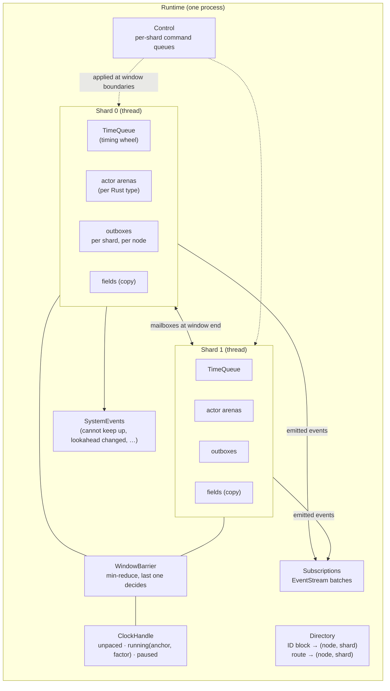
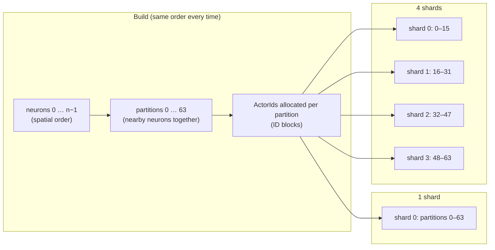
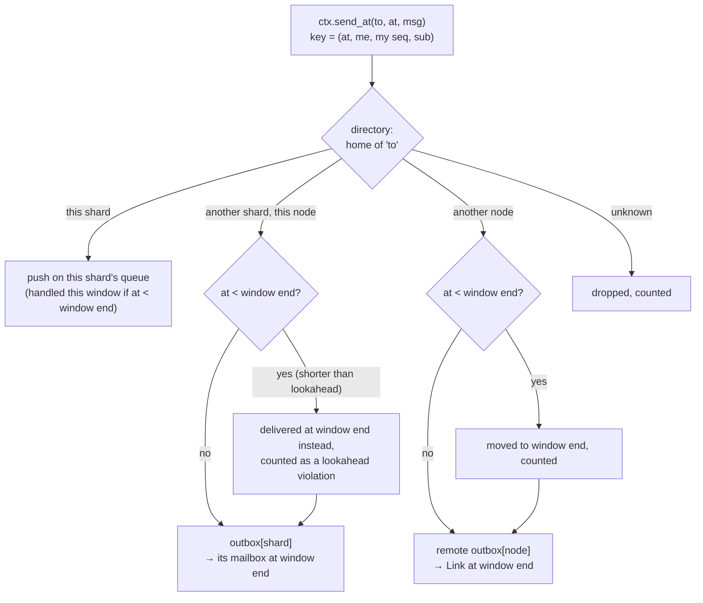
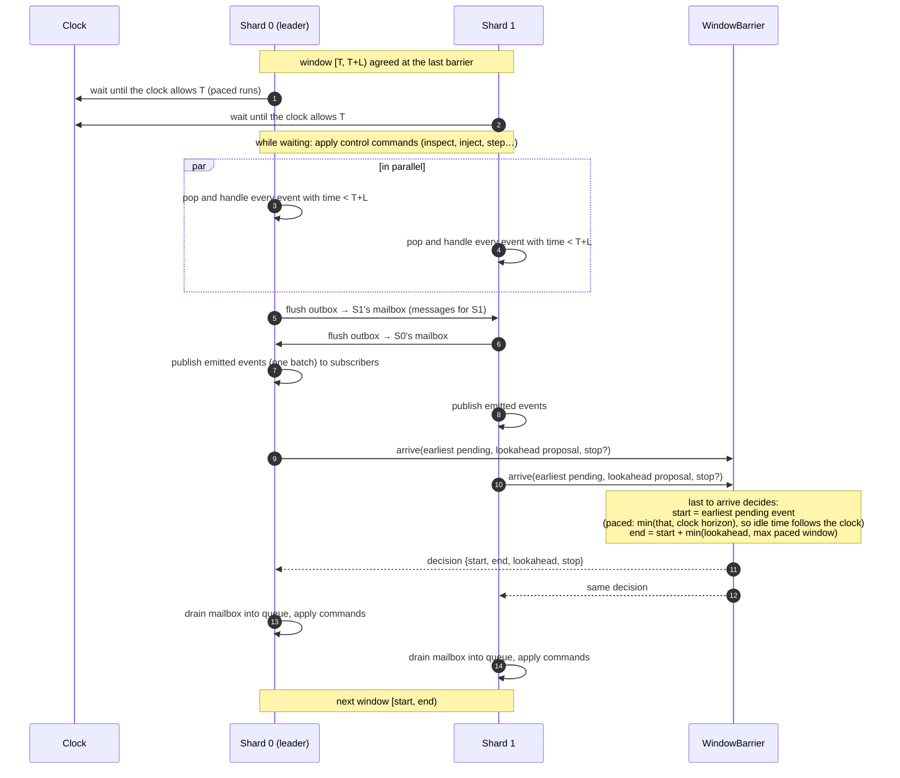
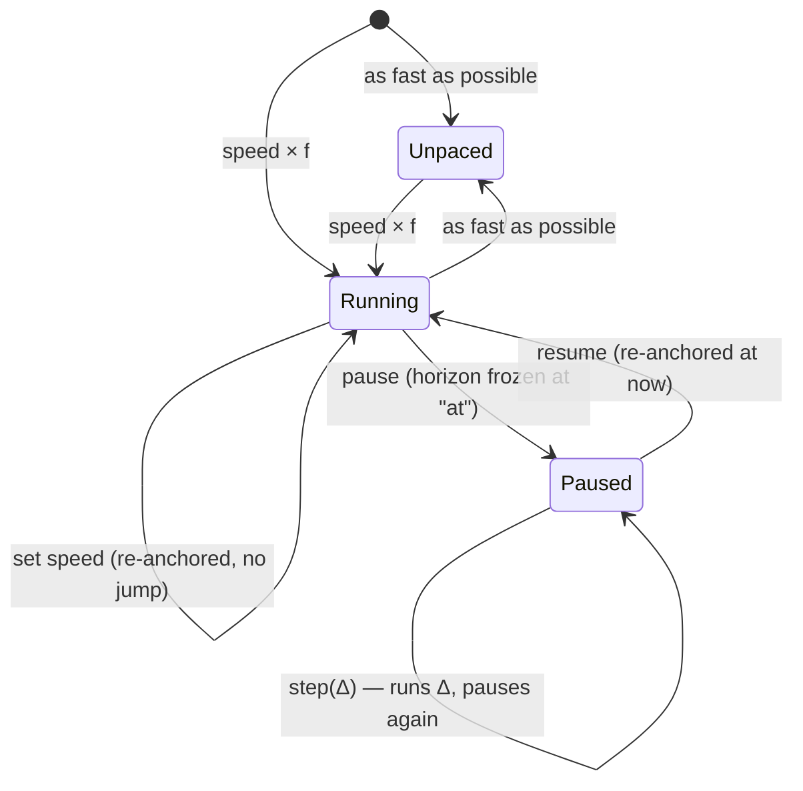
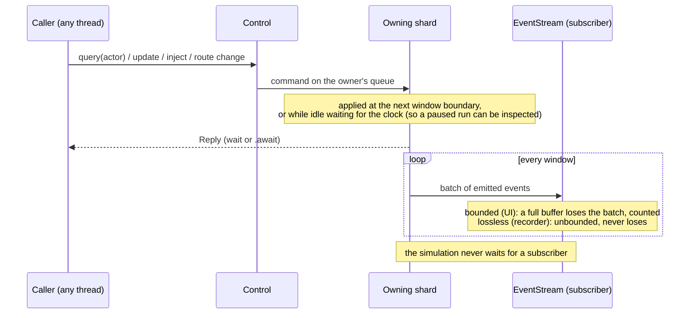

# The tempo runtime

`tempo-runtime` runs millions of small actors in simulated time, in parallel, with results that don't depend on how
many threads run them. This page explains how, from the actor up to the window loop.

## The ideas in one paragraph

An **actor** is a plain struct with a handler. Every message carries the exact **simulation time** it is delivered
at, and messages are handled strictly in `(time, sender, sequence, sub)` order (the `OrderKey`), so actors never see
the wall clock. Actors are grouped into **partitions** (64 by default), and partitions are spread over **shards**,
one thread each. Shards run in parallel through **conservative time windows**: no message between shards can be
shorter than the **lookahead** `L` (the smallest cross-shard delay), so everything in a window `[T, T+L)` can be
processed without hearing from the other shards. At the end of each window the shards meet at a **barrier**,
exchange the messages they made for each other, and agree on the next window. A **clock** decides how far windows
may run: as fast as possible, or paced against the wall clock (speed, pause, step).

## Inside one process

- **No thread, task or mailbox per actor.** Actors live in per-type arenas on their shard; dispatch is one virtual
  call per ID block, then static calls into the actor's handler. Millions of neurons fit in memory.
- **One time-ordered queue per shard** (`tempo-queue`: a hierarchical timing wheel, or a heap). It always yields the
  smallest `OrderKey`.
- **Fields** (neuromodulators, for example) are shard-local copies, updated by timed broadcasts and read lazily by
  actors at their own time and position.

## IDs, partitions and shards: why the shard count doesn't change results

An actor's ID depends only on its partition and the order it was spawned in, never on the shard count. Its random
stream is seeded from the run's seed and its ID. Event order is `(time, sender, sequence, sub)`, which doesn't
mention shards. So the same network gives the same results on 1 shard or 16. Contiguous ranges of
spatially-ordered partitions keep most connections inside a shard, and make the cross-shard ones the long, slow
ones, which raises the lookahead.

## Where a message goes

Fan-out **routes** (one spike to all of a neuron's targets, each with its own delay), **broadcasts** (to a group or
a region of space) and **field updates** are sent as one message per shard (or per node) and expanded where they
arrive, so reaching a million actors costs a handful of messages.

## One window, step by step

Every shard runs the same loop (`Shard::work`). The barrier reduces two values across shards (the earliest pending
event and the proposed lookahead), and the last shard to arrive turns them into the next window's **decision**.
Everyone gets the same decision, so the shards agree on window boundaries even when the decision depends on the
wall clock.

Unpaced (as fast as possible), idle stretches are skipped: the next window starts at the next pending event. Paced,
windows follow the clock through idle stretches, so input injected meanwhile is handled promptly.

## The clock

Running, the clock maps wall time to simulated time: `horizon(w) = anchor_sim + (w − anchor_wall) / time_factor`.
The horizon is the latest simulated time shards may reach, so it limits how far they run. It never sets the time an
actor sees, which always comes from its message. The leader shard compares the time each window was due with when it
started. If it falls behind by more than a threshold, it publishes `CannotKeepUp`, and `CaughtUp` once it recovers.

Stop is not a clock state: `stop()` bumps a stop epoch, and a run taken with an earlier stop token ends at its next
barrier. The clock itself keeps its mapping. That's why Spikes measures "behind the clock" only while a run goes
([spikes-on-tempo.md](spikes-on-tempo.md)).

## Control and subscriptions: touching a running simulation without stopping it

## Code map

| Concern | Where |
| --- | --- |
| Time, IDs, order keys | `crates/tempo-core/src/{time,id,envelope}.rs` |
| Queues | `crates/tempo-queue/src/{wheel,heap}.rs` |
| Window loop, send paths, outboxes | `crates/tempo-runtime/src/shard.rs` |
| Barrier and decision | `crates/tempo-runtime/src/barrier.rs`, `decide` in `shard.rs` |
| Partitions and placement | `crates/tempo-runtime/src/placement.rs` |
| Clock | `crates/tempo-runtime/src/clock.rs` |
| Control plane, subscriptions, system events | `crates/tempo-runtime/src/{control,subscribe,system}.rs` |
| Routes, broadcasts, fields | `crates/tempo-runtime/src/{route,broadcast,field}.rs` |
